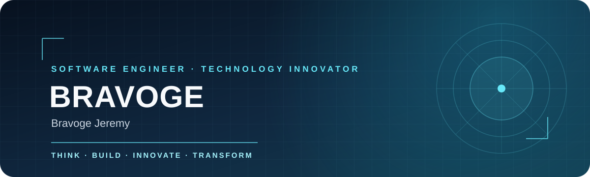

  

  

  <strong>Building technology that solves real-world problems.</strong> 
  
  
  

---

## About Me

I'm Bravoge Jeremy, a software developer from Kenya passionate about building meaningful digital experiences, scalable applications, and technology-driven solutions.

My programming journey began in 2022, learning HTML and CSS on a smartphone. That curiosity grew into a commitment to software engineering, problem-solving, and building systems that make a difference.

I explore frontend development, backend engineering, databases, APIs, system architecture, and deployment. I believe technology should do more than look impressive: it should solve problems, simplify processes, and create opportunities.

## What I Do

- **Full-stack development:** Building complete web applications and digital platforms.
- **Frontend engineering:** Developing responsive, intuitive user interfaces.
- **Backend engineering:** Building REST APIs, authentication systems, and business logic.
- **Database engineering:** Designing relational databases and managing application data.
- **System development:** Creating management systems for education and organizational operations.
- **Deployment and DevOps:** Managing Git workflows, cloud hosting, and application deployment.
- **Technology exploration:** Exploring mobile development, robotics, automation, and AI.

## Technology Stack

  
  
  
  
  

  
  
  
  
  
  

  
  
  
  
  
  

## AI-Assisted Development

I use AI-powered development tools to improve productivity, understand complex codebases, accelerate workflows, and explore new ideas.

  
  
  
  

AI is a development assistant, not a replacement for engineering knowledge. I focus on understanding generated code, debugging, architecture, and building reliable solutions.

## What I'm Building

I enjoy developing software with practical applications and meaningful impact:

- **School management systems:** Platforms for administration, learner and staff management, academic records, and institutional operations.
- **Web applications:** Full-stack applications using modern frontend and backend technologies.
- **API development:** Backend services, authentication, integrations, and database-driven applications.
- **Digital platforms:** Solutions that connect people, organizations, and technology.

I'm particularly interested in building reliable platforms that can grow from small solutions into systems serving larger communities.

## Currently Exploring

- Flutter and Dart for cross-platform mobile development.
- Advanced React and frontend architecture.
- Node.js backend engineering and API architecture.
- PostgreSQL optimization and database design.
- Cloud infrastructure and deployment.
- Robotics, artificial intelligence, and automation.
- Software architecture and system design.

## Beyond Writing Code

Technology is more than programming. I'm also interested in technology entrepreneurship, team collaboration, digital media, technology communities, educational technology, and using technology to address challenges in society.

## GitHub Analytics

  

  

  

## Contribution Activity

  

  

## GitHub Achievements

  

## Let's Connect

I'm always interested in connecting with developers, designers, innovators, and people building meaningful technology.

  
  
  

  <a href="https://twitter.com/Jeremybravoge">Twitter / X</a> ·
  <a href="https://instagram.com/sys.deve">Instagram</a> ·
  <a href="https://www.facebook.com/profile.php?id=100094417877954">Facebook</a>

  <a href="mailto:codemaster5362@gmail.com">codemaster5362@gmail.com</a>

## My Philosophy

> Don't just learn technology. Understand it, experiment with it, build with it, and use it to make a difference.

  <strong>BRAVOGE — THINK. BUILD. INNOVATE. TRANSFORM.</strong> 
  <em>Every line of code is another opportunity to create something meaningful.</em>

