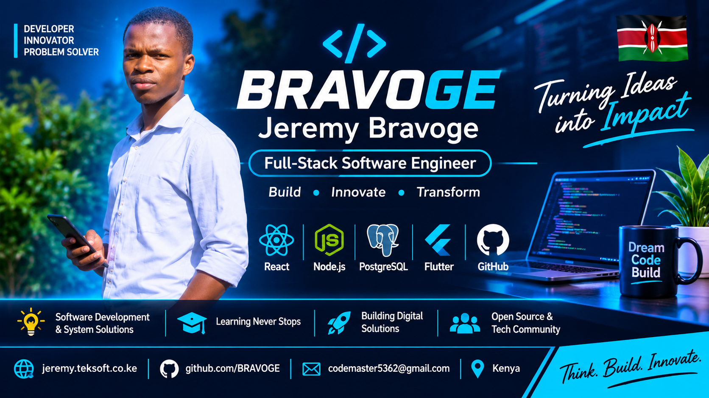

<h1 align="center">Hey, I'm Bravoge Jeremy 👋</h1>

<h3 align="center">Full-Stack Software Engineer | Problem Solver | Technology Enthusiast</h3>

  <strong>Building technology that solves real-world problems.</strong>

I'm a software developer from Kenya with a passion for building meaningful digital experiences, scalable applications, and technology-driven solutions.

My journey into programming began in 2022, when I started learning HTML and CSS using a smartphone. What started as curiosity gradually developed into a serious interest in software engineering, problem-solving, and building systems that make a difference.

Today, I work across frontend development, backend engineering, database management, API development, and application deployment. I enjoy taking ideas from conception to implementation, exploring new technologies, and continuously improving my engineering skills.

I believe technology should not just look impressive; it should solve problems, simplify processes, and create opportunities.

---

## 🚀 What I Do

- **Full-Stack Development:** Building responsive web applications and complete software solutions.
- **Frontend Engineering:** Creating intuitive, accessible, and user-friendly interfaces.
- **Backend Engineering:** Developing server-side applications, REST APIs, authentication, and business logic.
- **Database Engineering:** Designing and managing relational databases and application data structures.
- **System Development:** Building management platforms and solutions for real-world organizational needs.
- **Deployment & DevOps:** Working with Git, GitHub, cloud hosting, and application deployment workflows.
- **Technology Exploration:** Exploring mobile development, robotics, automation, and emerging technologies.

---

## 💻 Technology Stack

### Frontend Development

### Backend Development

### Databases & Backend Services

### Tools, Platforms & Deployment

---

## 🏗️ What I'm Building

I enjoy working on projects that have practical applications and meaningful impact.

Some of the areas I work in include:

- **School Management Systems:** Developing digital platforms for school administration, learner management, staff management, academic records, and institutional operations.
- **Web Applications:** Building full-stack applications with modern frontend and backend technologies.
- **API Development:** Designing backend services, authentication systems, and database integrations.
- **Digital Platforms:** Exploring solutions that connect people, organizations, and technology.

I'm particularly interested in building software that can grow from small solutions into reliable platforms serving larger communities.

---

## 🌱 Currently Exploring

My learning journey never stops. I'm expanding my knowledge in:

- Flutter and Dart for cross-platform mobile development.
- Advanced React and modern frontend architecture.
- Node.js backend engineering and API architecture.
- PostgreSQL database optimization and system design.
- Cloud infrastructure and deployment.
- Robotics, automation, and the intersection of software and hardware.
- Artificial Intelligence and its practical applications.

---

## 🧠 Beyond Writing Code

I believe being a software engineer involves more than programming.

I'm also interested in:

- Technology entrepreneurship and innovation.
- Team collaboration and project coordination.
- Digital media, video production, and creative technology.
- Building technology communities and sharing knowledge.
- Using technology to address challenges in education and society.

I enjoy learning, experimenting, documenting ideas, and collaborating with people who believe in creating useful things.

---

## 📊 GitHub Overview

  

  

  

---

## 🌍 Let's Connect

I'm always interested in connecting with developers, designers, innovators, and people building meaningful technology.

- 🌐 **Portfolio:** [jeremy.teksoft.co.ke](https://jeremy.teksoft.co.ke)
- 💻 **GitHub:** [github.com/BRAVOGE](https://github.com/BRAVOGE)
- 🏢 **Teksoft:** [teksoft.co.ke](https://teksoft.co.ke)
- 📧 **Email:** codemaster5362@gmail.com

---

## 💬 My Philosophy

> Don't just learn technology. Understand it, experiment with it, build with it, and use it to make a difference.

<h3 align="center">BRAVOGE — Think. Build. Innovate. Transform.</h3>

  <em>Every line of code is another opportunity to create something meaningful.</em>

